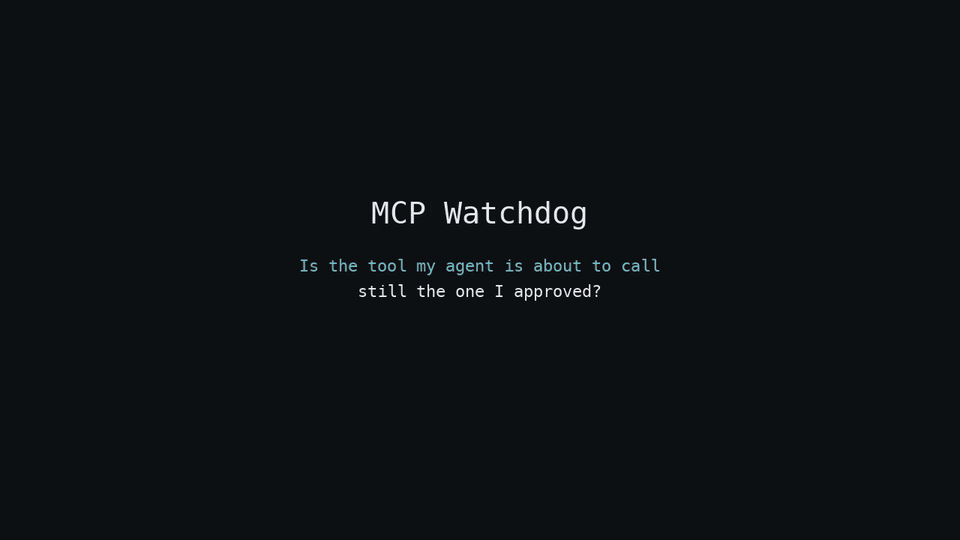

# MCP Watchdog

[](https://github.com/Ajaggi24/mcp-watchdog/actions/workflows/ci.yml)

**Is the tool my agent is about to call still the one I approved?**

An AI agent's tool definition can change after a developer approves it. A change alert tells the developer to look, but they still have to work out what changed and how urgently it needs review. MCP Watchdog shows the exact change, explains the review priority it assigned, and pauses calls to the changed tool until a developer approves it.



**Results (v1 rules, 22 held-out tool changes written after the rules were frozen):** 7 of 9 sensitive changes were ranked high priority, 2 of 11 routine changes were wrongly ranked urgent, and 0 changes skipped review. The top 9 slots of the review queue held 7 sensitive changes, compared with about 4 for a hash-only alert. The v2 rules fix all five v1 failures with no regressions on the dev set, and are frozen pending a new held-out evaluation. See [RESULTS.md](RESULTS.md).

## Why now

OWASP's Q3 2026 GenAI exploit roundup describes an MCP server that behaved normally for its first few tool calls and then changed its tool metadata to steer connected agents toward SSH keys, cloud credentials and Kubernetes configs. OWASP's suggested mitigation is to snapshot tool definitions at approval time and require re-approval when they change. Several tools already do that with hash pinning (see related work). Watchdog adds the next step: **which change should you look at first, and why?**

## What it does

- **Snapshots** each approved tool's name, title, description, input/output schemas and annotations.
- **Re-checks mid-session** whenever the server sends `notifications/tools/list_changed`, and again on every reconnect. A call that races a pending notification is re-checked before it goes out.
- **Diffs at field level**, e.g. `+ inputSchema.properties.file_path`, with word-level description diffs. Invisible characters are made visible (`<U+200B>`).
- **Prioritizes the review queue** as high, medium or low, with a plain-English reason, e.g. *"new field 'file_path' suggests file access"*.
- **Pauses calls** to every new or changed tool, whatever its priority. Priority only orders the queue; it never approves anything.
- **Ignores formatting-only changes**, such as reordered JSON keys or a reordered `required` list.
- **Writes a visual review page** (`--html`). See [docs/review_example.html](docs/review_example.html).

## Quick start

```bash
pip install -e ".[dev]"
python demo/live_demo.py          # the scripted demo
python demo/live_demo.py --step   # press Enter between scenes, for recording
pytest -q                         # 26 tests, including live stdio sessions and the proxy (also run by CI on every push)
```

## CLI

```bash
S="python demo_server/server.py demo_server/defs/v1_approved.json"
python -m mcpwatchdog approve --server "$S"                 # snapshot all tools (or --tool NAME)
python -m mcpwatchdog check   --server "$S"                 # exit 1 if anything needs review (CI gate)
python -m mcpwatchdog check   --server "$S" --html out.html # plus a visual review page
python -m mcpwatchdog review  --server "$S"                 # approve pending tools one by one, most urgent first
python -m mcpwatchdog proxy   --server "$S"                 # run in front of a real host (see below)
```

Approvals are stored in `.watchdog/approved.json`, keyed by server name.

## Use it with Claude Code or Cursor (proxy mode)

`mcpwatchdog proxy` sits between a real MCP host and the server it would normally launch. The host starts the proxy, and the proxy starts the real server.

- **Only approved tools are listed to the host.** A changed or new tool is withheld entirely, so the model never reads the unapproved description, not just never calls it.
- **Calls to withheld tools are refused** with an error saying review is needed.
- **Mid-session changes are forwarded** to the host as `tools/list_changed`.
- **Approvals take effect live.** Approve in another terminal and the tools reappear without restarting the host.
- **Every check is logged** to stderr, and a review page is written to `--html` (default `.watchdog/review.html`).

Use absolute paths, because the host may start the proxy from any directory:

```bash
PY=/absolute/path/to/mcp-watchdog/.venv/bin/python
SERVER="python /absolute/path/to/your_server.py"
STORE=/absolute/path/to/mcp-watchdog/.watchdog/approved.json

# 1. Review and approve the server's tools once
$PY -m mcpwatchdog approve --server "$SERVER" --store "$STORE"

# 2a. Claude Code
claude mcp add --transport stdio notes -- "$PY" -m mcpwatchdog proxy --server "$SERVER" --store "$STORE"
```

```json
// 2b. Cursor: .cursor/mcp.json (or ~/.cursor/mcp.json)
{
  "mcpServers": {
    "notes": {
      "command": "/absolute/path/to/mcp-watchdog/.venv/bin/python",
      "args": ["-m", "mcpwatchdog", "proxy",
               "--server", "python /absolute/path/to/your_server.py",
               "--store", "/absolute/path/to/mcp-watchdog/.watchdog/approved.json"]
    }
  }
}
```

When a tool changes, it disappears from the host until you run `review` (or `approve`) with the same `--server` and `--store`.

The proxy is covered by an end-to-end test (`tests/test_proxy.py`) that uses a plain MCP client in place of the host. The Claude Code and Cursor configurations above follow each tool's documented format, but this repo doesn't test them automatically.

## Use it in your own client

```python
from mcpwatchdog.client import connect
from mcpwatchdog.gate import ApprovalStore, ToolPaused

async with connect("python my_server.py", ApprovalStore()) as g:
    for item in g.gate.report.pending:            # review queue, most urgent first
        print(item.priority.label, item.name, item.assessment.reason)
    try:
        await g.call_tool("read_note", {"note_id": "n1"})
    except ToolPaused as e:
        print(e.report.changes)
```

## How priority works

`mcpwatchdog/priority.py` applies simple, explainable rules to what was *added or changed*. Text already present in the approved definition doesn't raise the priority again.

| priority | triggered by |
|---|---|
| **high** | sensitive field names (`file_path`, `api_token`, `callback_url`, `cmd`…); new text mentioning local paths, credentials, secrets, shell execution or outbound URLs; instruction-like text aimed at the model (`<IMPORTANT>`, "do not tell", "also pass"…); scope-broadening wording ("any file", "on this machine"); `readOnlyHint` dropped or `destructiveHint` added; new outbound defaults (email/URL); invisible or look-alike characters; encoded blobs |
| **medium** | any other schema change; new tools with no sensitive signal |
| **low** | wording-only changes to descriptions and titles |

## Benchmark

[`bench/`](bench/) contains 62 labeled tool-definition changes (40 dev, 22 v1 held-out) as JSON, a template for a new held-out set, an evaluator that compares Watchdog with raw-hash and canonical-hash baselines, and the generated results. The dataset is tool-agnostic, so you can run your own prioritizer against it.

## Project layout

| path | role |
|---|---|
| `mcpwatchdog/snapshot.py` | canonical form + SHA-256 fingerprint |
| `mcpwatchdog/diff.py` | recursive field-level diff, word diff, invisible-character reveal |
| `mcpwatchdog/priority.py` | review priority + reasons |
| `mcpwatchdog/gate.py` | approval store, per-tool status, review queue, call gate |
| `mcpwatchdog/client.py` | wraps the MCP SDK `ClientSession`; re-lists on `list_changed`; gates `call_tool` |
| `mcpwatchdog/proxy.py` | stdio proxy for real hosts: withholds unapproved tools, forwards changes, reloads approvals |
| `mcpwatchdog/html.py` | visual review page |
| `demo_server/` | mock stdio MCP server that reloads its tools from a JSON file |
| `demo/` | scripted live demo + video renderer |
| `bench/` | labeled cases, evaluator, results |

## Scope and limitations

- **Definitions, not behavior.** A server can keep its metadata identical and still return malicious output (indirect prompt injection). Watchdog doesn't see that.
- **Protects only traffic that goes through Watchdog,** either the client library or the proxy. A host connected to the server directly is not protected.
- **A server that changes tools without sending `list_changed`** is caught at the next re-list or reconnect. Until then, the model keeps working from the definitions it was shown at approval.
- **Keyword rules are brittle.** See the held-out misses in [RESULTS.md](RESULTS.md). An LLM classifier evaluated on the same held-out set is the obvious next step.

## Related work

[mcp-scan](https://github.com/invariantlabs-ai/mcp-scan), RugSnare, toolprint, mcp-pin and agent-aegis detect tool-definition changes by hash pinning. AI Security Gateway also assigns change severities. OWASP's MCP Top 10 recommends definition pinning with re-review. I couldn't find a public evaluation of how well change *prioritization* works, and that evaluation is this project's main contribution.

Built with the MCP Python SDK 2.3. Requires Python 3.10+.
